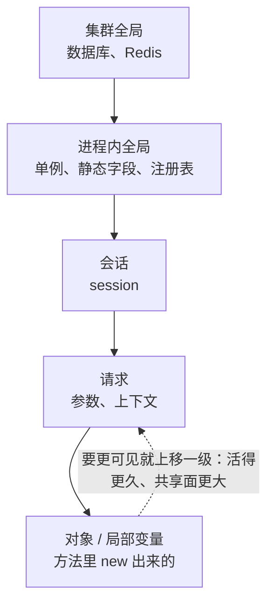

# 编程偏好

大部分代码形状由两个问题决定：**这份状态归谁**（作用域），**这东西是不是一个对象**（状态和方法要不要待在一起）。剩下的是纪律：方法小、参数少、扩展点能注册。

例子里的类型名、方法名只是示意（`LoadFailedException`、`Kind` 这类换成你自己领域的名字即可），**判据比例子重要**。

## 适用场景

- 新增或重构一个库、模块、服务接口。
- 评审：状态放哪、参数有没有意义、方法是不是太大、扩展点能不能加。
- 被要求「加个回调」「返回 Promise」「并行处理一批文件 / 请求」时（先按本规范判断要不要这么做）。

## 一、作用域：先给状态找归属（核心）

作用域是**人为划分的生命周期层级**：同一份数据放在哪一级，决定它活多久、被谁看见、多少人共享。典型划分（任一层都可以增删、自定义）：

| 作用域 | 生命周期 | 共享程度 | 典型载体 |
| --- | --- | --- | --- |
| 集群全局 | 整个集群 | 全员共享 | 数据库、Redis |
| 进程内全局 | 一个进程 / 一个实例 | 单实例内共享 | 单例 bean、全局静态字段、注册表 |
| 会话 | 一次登录 | 同一用户的所有请求 | session、cookie id 对应的数据 |
| 请求 | 一次请求 | 这一次调用 | 请求参数、请求头、调用上下文 |
| 对象 / 局部变量 | 一次使用 | 不共享 | 方法里 `new` 出来的对象、临时变量 |

结构性事实三条：

1. **一对多**：上一级对下面任何一级（不论隔几级）都是一对多。HTTP 栈里同一套关系也成立：tomcat → servlet context（`server.servlet.context-path`）→ servlet（`spring.mvc.servlet.path`）→ controller（类 / 方法上的映射），每一级都是一对多。
2. **可见性单向**：下级能读上级，上级读不到下级。变量查找天然就是这个方向——BPMN 里一个变量从 task → 子流程 → 流程实例 → 外层 bean 一级级往上找，反过来拿不到。要「让上面也能看到」，实际动作是**把状态提升到上一级**——临时变量改成全局静态字段、session 放进 Redis 做成集群共享、请求态挂进 `ThreadLocal` 多一层线程作用域。代价是生命周期变长、共享面变大，并发与清理都要重新想。
3. **层数由运行时决定，不由名字决定**：单进程同步模型（PHP-FPM 那样一个请求一个进程）里「进程全局」与「请求作用域」根本是同一层；线程池模型里请求与对象之间还会多一层线程作用域。所以别照抄层级表，先看这段代码真实的生命周期。

代码里这条同样成立，只是层级更短：**模块级单例 → 某个对象的字段 → 方法参数 / 局部变量**。判据始终是「**这个状态跟着谁活、跟着谁死**」：

| 作用域 | 放哪 | 放什么 |
| --- | --- | --- |
| 模块 / 进程 / 全局 | 单例（`object`）、模块级私有字段 | 注册表、缓存、创建实例的工厂方法、全局重置 |
| 与一个文件 / 一次任务 / 一个请求相关 | 那个实例的字段 | 输入、创建出来的对象、结果、等待者、重试计数 |
| 只在一次调用内成立 | 参数、局部变量 | 中间结果 |

典型反例：**全局的 `markDone(id, result)`**——它改的其实是「那个 id 对应的对象」的状态，所以它该是那个对象的方法。若这份状态散成三张全局 map（`是否完成`、`结果`、`等待者`）加一个计数器，那它本来就是一个实例的三个字段。

落地顺序：

1. 散落的状态 → 实例字段（`finished: Boolean`、`outcome: Result<…>?`、`waiting: MutableList<…>`）。
2. 全局函数里的调度逻辑 → 实例方法：对外入口只留一行委托，真正的「查表 → 置位 → 执行 → 收尾 → 报错」搬进实例方法。
3. 单例的公开面收缩到「**拿到实例** + 真正的全局查询」：按 id 拿到（必要时创建）实例的方法留在单例，「这个 id 交给过任务吗」「整体重置」这类全局事实也留在单例；其余一律通过实例暴露。
4. 实例复用语义写清楚：同 id 同对象（`getOrPut`），**取**第二次不该报错（那是复用），**执行**第二次才该报错（那是重复执行）——两件事别混成一个异常。

自检两句：

- **这个函数不带「对象」也能调用，它才属于单例。**
- **这份状态交给上一级之后，谁负责清理？** 答不上来，说明作用域提错了。

## 二、对象同时持有状态与方法；参数是没归位的状态

对象的意义是「状态和操作它的方法待在一起」，`this` 是那根隐含的线：方法内部访问字段不用传参。Python / Go 显式写 `self` / `receiver`，恰恰说明**方法就是带上状态的那个函数**，没有状态就没有方法。

反例是 **Dto 只装状态、Service 只装方法**的两分法：所有方法都被迫通过参数列表接力，字段一多、参数就膨胀，复用也跟着散。修法是**命令对象**（《重构》11.9「以命令取代函数」）：

- 一个方法有 4 个以上参数，就说明这堆参数本来就是一份状态 → 抽一个操作类，参数变字段，类里一个 `execute()`。
- 抽出来的方法尽量**不带参数**：无参方法近似幂等，可以反复调用、也可以继续往下递归细分。参数列表是继续抽方法的最大阻力（普通全局 service 里改一次参数，所有调用点都要重签）。
- 操作类可以被容器注入（如 Spring `prototype` bean 自动装配），不必手工 `new` 到底。
- 一次性的小函数不必抽类；判据是**参数数量与状态寿命**，不是「面向对象就必须有类」。

## 三、方法要小，且一个方法一个语义

- 方法尽量不超过 10 行。超过 10 行基本意味着里面有两个以上语义，按语义再抽。
- 语义明确时，**一句代码也可以抽成一个方法**——抽的动机是可读性与可复用，不是行数阈值。
- 方法名就是那段语义，别用 `handle` / `process` / `doXxx` 盖住真正的动作。
- 机械重复的 `get` / `set` 不算「两个语义」，但也不用手写：交给 IDE / 生成器，出 bug 的概率更低。

## 四、扩展点必须能被识别，也必须能被注册

「可扩展」不是写一段空接口就完事，它是**功能**：主体逻辑要能发现并使用新实现。

- 注册途径：IoC 容器、注入一个实现列表（`List<InterfaceType>`）、手动注册到一处、类扫描（靠注解 / 接口 / 父类这类特征识别）。
- 实现途径：继承（覆写预留的空方法 / 抽象方法）或实现接口。
- 判据：**新增一个实现，要不要改主体代码？** 要改，就说明这条扩展点没做成，只是把 `if` 换了个位置。

## 五、一次算清、只算一次的东西 → 惰性字段

- 分支判定（按输入的形态决定走哪条路、建哪种对象）→ `private val kind: Kind by lazy { … }`，不要每次调用重判一遍。
- 环境探测（`'noModule' in document.createElement('script')`）→ `by lazy`：只探一次，但仍延迟到真的要用的路径（预渲染 / Node 路径不会被它拖下水）。
- 创建出来的对象也是状态 → 挂成实例字段，后续方法不再收这个参数（`finish()` 而不是 `finish(created)`）。

判据：**算一次就够、且可能永远用不上的**归 `by lazy`；每次都要重新算的才是普通属性。

## 六、异步：协程 + 类型化异常，别把回调搬进来

- 回调参数 → `suspend fun`；返回 `Promise` → 也改 `suspend`（内部 `suspendCoroutine` 桥接），调用方就不必同时维护两套等待方式。
- 失败用**类型化异常**，并把能定位问题的最小信息放进字段：单条给「哪一个输入」（如 `LoadFailedException(path)`），批量给「哪些没成功」（如 `LoadsFailedException(paths)`）。别用 `Result` 到处传、别用布尔返回值。
- 多方等同一个事件：`MutableList<Continuation<Unit>>` 收着，完成时统一 resume；不要 Promise 数组、回调数组。
- 终态要缓存：已经完成的请求，后到的等待者立刻按同一个结果（成功或失败）答复——「立刻返回」与「稍后才返回」必须都能正确。

## 七、批量 = 重载 + 并发的单条调用，不是第二套实现

- 单条 API 定好之后，列表版就是一行结构化并发：`supervisorScope { paths.map { async { 单条(it) } }.awaitAll() }`。
- 用 `supervisorScope` 而不是 `coroutineScope`：一条失败不该取消其余，因为我们要报「哪些没到」。
- 只 catch 你要分类的那个异常，**不吞取消异常**（`CancellationException` 必须继续往上走）。
- 失败报「缺了哪些、顺序照请求顺序」；已经成功的保持生效，不因兄弟失败回滚别人。
- 不要为批量自己写并行计数、队列、聚合回调——那是结构化并发已经做完的事。
- 批量不接「只对单次有意义」的参数（「一次执行一个 id」这类参数在列表版里没有对应物）。

判据：**能不能只用「单条 + 现成的并发原语」表达？** 能，就不要新写一条实现路径。

## 八、兑现不了的参数直接删

- 先问「这个开关真的改变行为吗」：动态插入的 `<script>` 的 `async` **属性**被浏览器 force-async 恒为 `true`，写 `async = false` 也不改变调度 → 这个参数删掉。
- 少一个参数永远比多一个参数好；留着它反而暗示「这个开关有用」，是语义污染。
- 同类：恒等的布尔位、没人会传的枚举、只有一个取值的 `mode`。
- 删参数时把注释里的说明一起删干净，别留一句「async 暂不支持」。

## 九、平台已经给的能力别再手搓

- 事件类型用常量（`Event.LOAD` / `Event.ERROR`），不写 `"load"` 字符串。
- 建元素用现成 DSL（kotlin-wrappers 的 `HtmlTagName.script { … }`、`TagName<T>.invoke`），不要 `createElement("div").apply { … }` 和 DSL 混着用。
- 写之前先查依赖里有没有：查源码、查类型（IDE 的类型继承 / 索引）、查生成代码。**「找不到」通常是查法不对，不是库没提供**；宁可多查一轮，也不要 `unsafeCast` 过去。
- 查清边界再动笔：哪些成员是 `internal`、尾随 lambda 会不会被当成最后一个参数。查到的结论写进仓库 `AGENTS.md`，别让下一个人再踩一遍。

## 十、依赖传递别猜，去查

- 「这个库应该带协程 / 带序列化」——解压 sources 或看 POM 里是 `api` 还是 `implementation`。`implementation` 不传给消费方，必须显式加坐标。
- 公共模块的**必备运行时**用 `api` 交出去：调用方写 `launch { … }` 时不用自己再加一行。
- 测试支撑库不要绕：要 `runTest` 就直接引 `kotlinx-coroutines-test`，手搓一条等待通道比引一个依赖贵得多。
- 版本跟同一生态对齐（如与 kotlin-wrappers 同版本），别为「新一点」单挑一个版本。

## 十一、测试要么断言到位，要么不算测过

- 异步用例直接写 `runTest { … }`（或返回 `Promise<Unit>`），**不 sleep**。
- 「永远不返回」的调用丢进 `backgroundScope`；需要推进调度时 `testScheduler.runCurrent()`。
- **证明断言真的被 await**：故意把断言改错再跑一次（探针），确认它会红。否则你不知道这条测试是不是空转。
- 失败用例走真实会失败的路径（未知 scheme 的 URL、404 资源），不要 mock 掉唯一被测的行为。
- 缓存语义都要钉住：同一个事实若有两个查询入口（准备前问一次、完成后又问一次），各写一条用例。

## 十二、文档与代码同一批改

- 结构、作用域层级、状态机、时序 → **mermaid**，不要只写段落和长表。
- 双语站点的文档成对改（EN / ZH），示例跟着新 API 形态走。
- 判据、坑、边界写进仓库 `AGENTS.md`；只写进 commit message 等于没写。

## 十三、质量底线：功能第一，其余是非功能性指标

先分清两类指标：

- **功能（functional）**：这段代码能干的事。不为任何「质量」理由牺牲其中任何一项。
- **非功能性指标（non-functional）**：可复用、可维护、可读、性能。它们不改变「能干什么」，只决定用起来、改起来有多贵。

优先级：**功能完备在前，其余按代价取舍**——性能允许微量损失，而且做对了常常更快、更省；反过来，为了「优雅」砍掉一个分支就是越界。

一个例外要点名：**「可扩展」听上去是非功能性的，落到实现上却是一段功能代码**——扩展点、注册表、扫描规则都要写、要测；只在注释里写「此处可扩展」等于没做。「可复用」同理，它的实现形式是消除重复的那条代码路径，不是一句承诺。

落到具体写法：

- **可复用**：只要出现重复代码，那几句（几十句）的复用性就已经损失了，先消重。
- **可扩展**：见第四节，判据是「加一个实现要不要改主体代码」。
- **简单易读**：小方法 + 具体命名 + 注释。
- **注释每处都写**：类、字段、方法都写；注释**不怕重复、不复用**，同义就直说（把注释抽成「复用」只会让它变模糊）。
- **命名即语义**：名字要能被单独读懂，不靠上下文补全。

## 评审清单

- [ ] 每份新状态都能说出它的作用域层级与生命周期；说不出来就是没归位。
- [ ] 有没有「上级去取下级」的逆流（请求态硬塞进全局静态字段只为「让它可见」）？
- [ ] 提升作用域之后，清理责任写清了吗？
- [ ] 有没有散落的 map / 计数 / 全局函数，其实该收成实例字段与方法？
- [ ] 参数 ≥4 个的方法，是不是该抽成命令对象（字段 + `execute()`）？
- [ ] 有没有 Dto 只装状态、Service 只装方法的强制两分，导致全员靠参数接力？
- [ ] 有没有超过 10 行的方法？里面是不是藏着两个语义？
- [ ] 抽出来的方法带了多少参数？能不能降到无参？
- [ ] 新增一个实现要不要改主体代码？扩展点靠什么被识别、注册在哪？
- [ ] 一次性计算、可能用不上的东西，是不是 `by lazy`？
- [ ] 还有没有「上游形状」的残留（回调参数、Promise 返回、照抄上游的参数顺序）？
- [ ] 批量是不是「重载 + 并发调用单条」？有没有偷偷存在第二套实现？
- [ ] 每个参数都能被兑现吗？有没有恒等开关、只有一个取值的枚举？
- [ ] 事件名、建元素、取值：用的是平台的类型安全写法，还是字符串 + 手搓？
- [ ] 依赖是 `api` 还是 `implementation`——查过，还是猜的？
- [ ] 异步测试有没有用「故意改错」证明断言真的生效？
- [ ] 类 / 字段 / 方法都有注释吗（允许重复、同义直说）？
- [ ] 文档（含 mermaid、双语、AGENTS.md）与代码同一批提交了吗？

## 禁止事项

- 禁止把「全局函数 + 全局 map」当成状态管理。
- 禁止逆流共享：为「让上层也看得到」把请求 / 会话态塞进全局静态字段或 `ThreadLocal` 而不管清理。
- 禁止用参数列表当状态容器（4 个以上参数还不抽操作类，接着往上加）。
- 禁止 Dto + Service 式强制两分，把对象拆成「只有字段」和「只有方法」两半。
- 禁止把回调式 API 原样搬进 Kotlin（含 `typealias` 回调参数）。
- 禁止留兑现不了的参数（典型：动态 `<script>` 的 `async`）。
- 禁止在批量里自己写并行计数 / 队列 / 聚合回调。
- 禁止用字符串写字面量事件名，禁止「找不到类型安全写法就 `unsafeCast`」。
- 禁止凭记忆判断依赖传递（没查就假设有、或没查就重复加坐标）。
- 禁止 `sleep` 式等待异步结果。
- 禁止为非功能性指标牺牲功能；也禁止在没有测量的情况下拿「性能」当不做归位的理由。

## 怎么在这里新增偏好

一节一条偏好，按「判据 → 正例 → 反例」写，别写成语言教程；新偏好作为**新的一节**追加（编号顺延），改动已有条目时只做收紧、不改原意，并在提交信息里说清是哪条被收紧。判据要能被别人拿去判断「我这个场景算不算」。

**例子必须脱离具体项目可读**：不许出现某个仓库内部的类型名 / 专属 API（`bundle`、`LoadFile`、某个 `done()` 这类），要举就举通用形态（「id → 对象的注册表」「全局 `markDone(id)`」）。这条是硬要求——例子一旦绑上某个项目，换个仓库读就是一段无法执行的死文本。
