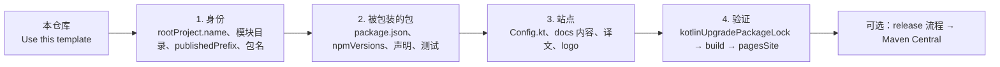

# 派生新项目

下面的假设是你从本仓库复制了一份（GitHub 的 **Use this template**，或者 `git clone` 后删掉 `.git`）。
没有占位符脚本要跑：流程就是改名，剩下没改到的地方由编译器和测试告出来。


每一步都只是改名，改得对不对由编译器和测试回答；顺序只决定你一次看到几个报错。

## 1. 身份

| 位置 | 改什么 |
| --- | --- |
| `settings.gradle.kts` | `rootProject.name`、模块的 `include(...)` |
| 模块目录 | 重命名；目录名、`include(...)` 与 `wrapper-revisions.properties` 的 key 三者必须一致 |
| `build.gradle.kts` | `publishedPrefix`（发布模块的筛选前缀）、POM 的 `url` / `scm`、`inceptionYear` |
| `LICENSE`、各个 README | 版权行与链接 |
| Kotlin 包 | 移动 `src/*/kotlin/io/github/shijianjs/...`，并改 `package` 行 |

## 2. 被包装的包

| 位置 | 改什么 |
| --- | --- |
| `package.json` | npm 包与它的版本——版本只在这里声明 |
| 模块 `build.gradle.kts` | `npmVersions.getValue("<包名>")` |
| `src/jsMain/kotlin/...` | wrapper 声明，按 `ktjs-type-mapping` 技能写 |
| `src/jsTest/kotlin/...` | 从上游测试翻译、按锁定的版本写断言 |
| `demo/src/jsMain/kotlin/.../demo/` | 演示站：`Main.kt` 挂上工具箱外壳，`SiteMenu.kt` 与 `SiteTexts.kt` 放导航和文案，`page/` 放真正用上 wrapper 的页面；包名跟着项目改 |

## 3. 站点

`docs/src/jsMain/kotlin/.../docs/Config.kt` 放着所有站点级取值：`title`、`tagline`、`url`、
`SITE_BASE_URL`（仓库名）、`REPOSITORY`，以及指向 `/demo/` 与 `/api/` 的两条链接。
`docs/src/jsMain/resources` 下只有内容；译文按同样的目录结构放在 `i18n/zh-Hans/`。

首页用工具箱的 `<ktjs-hero>` / `<ktjs-features>` / `<ktjs-next-steps>` 分区。`ClientModule.kt` 与
`docs/build.gradle.kts` 里的 `browserBundle` 接线照抄即可，只改文案。Logo 只有一份，在
`docs/src/jsMain/resources/static/img/`，demo 的 `brandAssets` 任务会拷进自己的资源；换 logo 时替换该文件，
并同步三处引用（`Config.kt`、`demo/src/jsMain/resources/index.html`、`demo/.../demo/SiteTexts.kt`）。

## 4. 验证

```bash
./gradlew kotlinNpmInstall
./gradlew kotlinUpgradePackageLock   # 锁文件里记着模块版本，这步不能省
./gradlew build
./gradlew pagesSite
```

然后把 GitHub Pages 的 Source 设成 **GitHub Actions**，手动跑一次 `Deploy demo and API reference`。
发布是可选的：`.github/workflows/release.yml` 会签名并把构件交给 Maven Central hub，首次运行前需要
`AGENTS.md` 里列的那些 secret。
